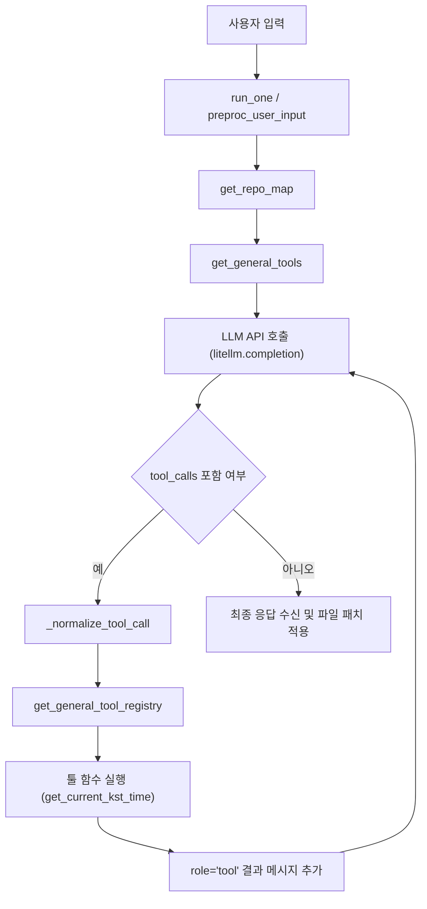

## Viper

AI Coding Agent

## Install

```bash
python -m venv .venv
.venv/Scripts/pip.exe install -r requirements.txt
```

## Run

```bash
.venv/Scripts/python.exe -m viper --model gemini/gemini-3.5-flash --api-key gemini=<YOUR_API_KEY> <프로젝트 폴더>
```

---

## Viper 에이전트의 LLM 호출 및 툴(Tool) 실행 구조

### 1. 실행 흐름 순서도



### 2. 핵심 함수 목록

- **입력 및 컨텍스트 구성:** `run_one`, `preproc_user_input`, `get_repo_map`
- **툴 조회 및 정규화:** `get_general_tools`, `get_general_tool_registry`, `_normalize_tool_call`
- **툴 실행 및 루프:** `run_with_tools`, `get_current_kst_time`

### 3. 성능 및 운영 참고 사항

- **주요 소요 시간:** Repo Map 캐시 적중 시 조회 시간(`~0.002s`)과 로컬 파일 패치 시간은 매우 짧으며, 전체 지연 시간의 대부분은 LLM 네트워크 왕복 및 추론·스트리밍(툴 호출 시 1회 추가 왕복 포함)에서 발생합니다.
- **툴 사용 전략:** 동적으로 외부/시스템 상태(현재 시각 등)를 조회해야 할 때는 Tool Calling을 사용하고, 매 요청마다 고정적으로 필요한 메타데이터는 프롬프트 컨텍스트에 직접 주입하면 추가 왕복 비용을 줄일 수 있습니다.
